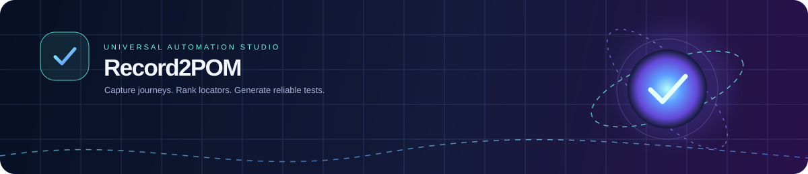
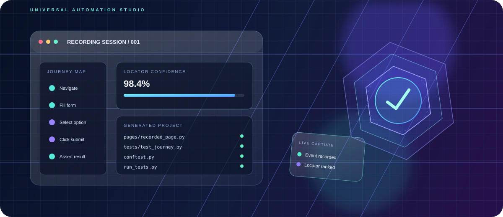
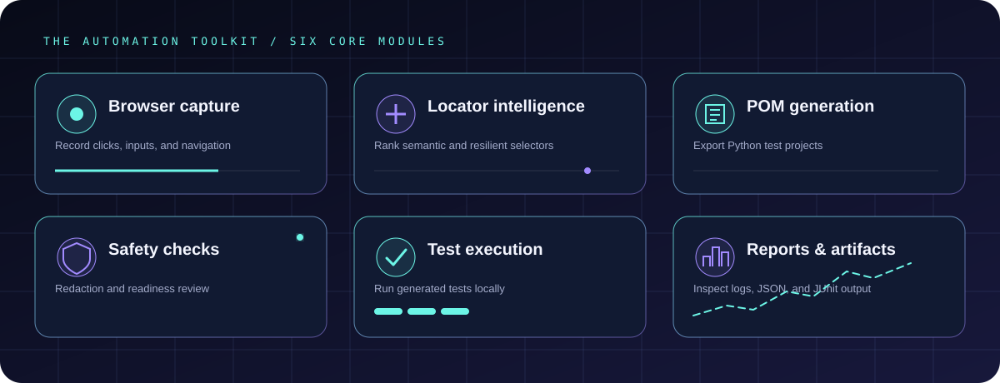
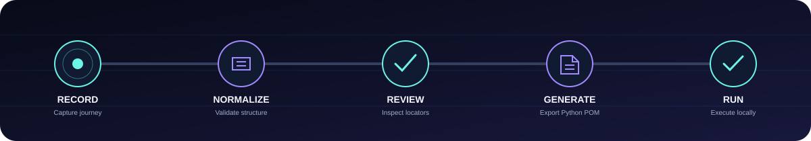
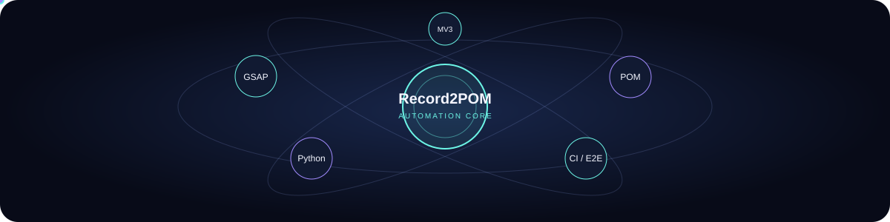

<div align="center">



# Record2POM — Universal POM Automation Studio

**Capture browser journeys. Review locator health. Generate portable Python automation projects.**

**Framework creator:** Satyendra Kumar Namdeo

[](https://record2pom.vercel.app/)
[](https://github.com/SanFlash/record2pom/actions/workflows/test.yml)
[](https://github.com/SanFlash/record2pom)

[🚀 Open Studio](https://record2pom.vercel.app/) · [✨ GSAP 3D Motion Lab](https://record2pom.vercel.app/showcase/) · [🧪 Latest CI run](https://github.com/SanFlash/record2pom/actions) · [📦 Source code](https://github.com/SanFlash/record2pom)

    

</div>

---

## ✦ The Motion Lab — GSAP + 3D

The Motion Lab is the animated product experience—not a static mockup. Its GSAP timeline reveals the hero, brings the 3D automation core into view, and staggers floating glass panels. Rotating scan rings, orbiting satellites, an ambient particle network, animated gradient typography, pulsing status lights, floating feature icons, a looping ticker, pointer-driven parallax, perspective tilt, and scroll-triggered reveals create a layered motion system while keeping the product workflow front and center.

**Motion design highlights**

- **Cinematic intro:** sequenced GSAP timeline with eased entrances and staggered cards.
- **Living 3D core:** rotating automation orb, orbit rings, perspective grid, and ambient gradient orbs.
- **Interactive depth:** pointer-responsive stage and code-window tilt, with floating cards that respond to movement.
- **Continuous motion:** smooth capability marquee and low-amplitude card levitation.
- **Scroll storytelling:** GSAP ScrollTrigger adds scroll-linked ambient parallax, section-heading entrances, and a scrubbed workflow sequence.
- **Layered graphics:** A capped, DPR-limited canvas particle network, rotating scan ring, orbiting satellites, animated gradient headline, pulsing status light, and gently floating feature icons add depth without WebGL.
- **Motion polish:** Hover shimmer, interactive feature-card tilt, magnetic CTA movement, animated code-window perspective, and pause-on-hover ticker interactions respond to pointer input.
- **Responsive by design:** desktop composition adapts to tablet and mobile layouts, with pointer interactions kept off touch-only devices by design.
- **Performance-aware motion:** scroll progress updates are animation-frame coalesced, and all GSAP timelines pause while the browser tab is hidden.
- **Accessible fallback:** `prefers-reduced-motion` disables continuous movement and reveals content without animation; core content remains readable if GSAP or ScrollTrigger fails to load.

> GitHub README Markdown cannot execute GSAP JavaScript. The animated SVG banner below is the in-README visual; the live interactions run on the linked showcase page.

<div align="center">

[**OPEN THE INTERACTIVE 3D SHOWCASE ↗**](https://record2pom.vercel.app/showcase/)



</div>

> **GitHub rendering note:** GitHub README Markdown cannot execute arbitrary JavaScript or GSAP. The SVG banner provides an in-README visual, while the actual GSAP motion runs on the linked static webpage in [showcase/index.html](showcase/index.html). The showcase respects the reduced-motion browser preference and has responsive layouts.

## ✦ Motion graphics gallery

<div align="center">



**Capture** &nbsp; ✦ &nbsp; **Analyze** &nbsp; ✦ &nbsp; **Review** &nbsp; ✦ &nbsp; **Generate** &nbsp; ✦ &nbsp; **Execute** &nbsp; ✦ &nbsp; **Report**



</div>

### ✧ Orbiting technology ecosystem

<div align="center">



</div>

### ✦ Animated feature icons

<div align="center">

| Icon | Module | Purpose |
|:---:|---|---|
|  | **Browser capture** | Record supported interactions and navigation |
|  | **Locator intelligence** | Compare accessible roles, labels, test IDs, and CSS candidates |
|  | **Safety review** | Inspect redaction, ambiguous selectors, and missing assertions |
|  | **Code generation** | Build Python Page Objects and test files |
|  | **Local execution** | Run generated tests in your own environment |
|  | **Reports & artifacts** | Review JSON results, logs, and JUnit output |

</div>

> **README animation note:** GitHub can display animated SVG assets, but it does not execute arbitrary page JavaScript. These SVG graphics use lightweight SVG animation; full GSAP pointer interactions and scroll-linked effects live in the [interactive Motion Lab](https://record2pom.vercel.app/showcase/).

## ✦ What it does

Record2POM is a website-agnostic browser recording and Page Object Model (POM) project generator. It combines a static dashboard with a separately installed Chrome/Chromium Manifest V3 extension.

| Capability | What it provides |
|---|---|
| Browser recorder | Supported clicks, input changes, select changes, checkbox/radio changes, Enter, and navigation metadata |
| Locator intelligence | Candidate locators for data-testid, accessible role/name, labels, placeholders, CSS IDs, and compatible data-test / data-qa attributes |
| Recording normalization | Versioned intermediate representation, legacy alias normalization, bounded fields, and event-count limits |
| Safer recordings | Heuristic sensitive-value redaction, background re-validation, payload limits, and no file-input path capture |
| Readiness checks | Highlights missing URL/configuration, uncertain locators, missing assertions, and environment-dependent values |
| Code generation | Python + Playwright + pytest, or Python + Selenium + unittest |
| Project export | Client-side ZIP download of generated files |
| Local execution | Generated runner captures output and writes JSON/log/JUnit reports |

## ✦ How the workflow moves

<div align="center">

**RECORD** &nbsp; ⟶ &nbsp; **NORMALIZE** &nbsp; ⟶ &nbsp; **REVIEW** &nbsp; ⟶ &nbsp; **GENERATE** &nbsp; ⟶ &nbsp; **RUN LOCALLY**

</div>

1. **Record** an interaction journey on a website you are authorized to test.
2. **Import** the recording JSON into the dashboard.
3. **Review** actions, locator confidence, redaction, and assertions.
4. **Generate** the Page Object Model project and download its ZIP.
5. **Inspect and run locally** with the generated instructions, then review the result artifacts.

Generation is not test execution. The hosted dashboard does not run the generated tests or claim that they passed just because project files were created.

## ✦ Technology

<div align="center">


</div>

- **Dashboard:** HTML, CSS, JavaScript, local-first workflow
- **Browser extension:** Chrome Manifest V3
- **Generated projects:** Python + Playwright + pytest; Python + Selenium + unittest
- **Motion showcase:** GSAP 3, CSS 3D transforms, responsive glassmorphism, reduced-motion support
- **Hosting:** Vercel static deployment
- **Verification:** Node test suite + Playwright Chromium end-to-end fixture tests

## ✦ Local development

### Run the dashboard locally

Requires Node.js 20+.

```bash
git clone https://github.com/SanFlash/record2pom.git
cd record2pom
npm test
npm start
```

Open http://localhost:3000.

The npm test suite includes generator, recording-schema, redaction, locator, background lifecycle, recorder-harness, GSAP showcase, and README animated-SVG regression tests. The SVG checks confirm that each referenced motion asset exists, includes accessible title/description metadata, contains animation, and does not embed scripts. The GitHub Actions workflow additionally installs Chromium and runs the browser-based fixture and generated-project tests:

```bash
python -m pip install "pytest-playwright>=0.5,<1"
python -m playwright install --with-deps chromium
python -m pytest -q tests/e2e
```

### Run the browser-based fixture tests

The CI workflow installs Chromium and runs the fixture journeys and generated-project checks. Run the commands above from the repository root.

## ✦ Install the browser extension

1. Open chrome://extensions in Chrome or a compatible Chromium browser.
2. Enable **Developer mode**.
3. Choose **Load unpacked** and select the repository's extension/ directory.
4. Open an authorized HTTP/HTTPS test website and reload the page.
5. Start recording and try a safe fixture journey; test pause/resume and stop.
6. Export the recording and verify that password-like values and file paths are not present.
7. Import the JSON into the dashboard and review the generated project.

Some browser surfaces, closed shadow roots, cross-origin frames, popups, and highly customized widgets may require manual handling. The Node integration harness simulates the extension-to-Studio message contract; it is not a real installed-Chrome test. Before relying on the extension, manually verify Start → Pause/Resume → Stop → Studio import acknowledgement → Generate → ZIP download in Chrome and save screenshots with the test date, browser version, and result. Do not include secrets or real personal data in evidence.

## ✦ Generate and run a project

1. Set a project name and target URL.
2. Import the reviewed recording JSON.
3. Correct ambiguous locators and add explicit assertions where appropriate.
4. Generate the project and download the ZIP.
5. Extract it, create a Python virtual environment, install requirements, and install browser prerequisites for Playwright if needed.
6. Read the generated README and inspect the code before executing it.
7. Run the generated runner and review reports/run-results.json, reports/run.log, and JUnit output when applicable.

The generated runner uses an argument array rather than shell interpolation and applies a timeout. **It is not an operating-system sandbox.** Inspect generated code before running it.

## ✦ Supported generator combinations

- Playwright + Python + pytest
- Selenium WebDriver + Python + unittest

| Engine | Language | Test framework |
|---|---|---|
| Playwright | Python | pytest |
| Selenium WebDriver | Python | unittest |
| Other engines/languages | — | Not implemented |

## ✦ Security and scope

- Sensitive-value detection is heuristic and cannot guarantee that all secrets or personal information will be identified. Inspect recordings before sharing them.
- Use test credentials and synthetic data. Never commit secrets or record sensitive production sessions.
- The extension uses broad HTTP/HTTPS host permissions to support user-selected targets; review the permission request before installation.
- The dashboard has no accounts, database, hosted runner, server-side test execution, or cloud queue.
- Authentication, CAPTCHA, MFA, and access controls are not bypassed.
- Use the framework only on systems you own or have explicit permission to test.

## ✦ Motion design system

The live showcase and README visuals use a consistent dark-cosmic design language: midnight surfaces, cyan and violet energy lines, soft glow, glass panels, thin grid structures, and high-contrast labels.

| Motion layer | Visual treatment | Intent |
|---|---|---|
| Ambient | Particle network, gradient orbs, moving grid | Create depth without distracting from content |
| Hero | Sequenced reveal, orbiting core, floating status cards | Establish the automation identity |
| Interaction | Pointer tilt, magnetic CTA, hover shimmer | Give interface elements responsive feedback |
| Scroll | ScrollTrigger parallax and scrubbed workflow | Connect movement to page progression |
| Status | Pulsing signal lights, animated progress and line traces | Make system concepts easy to scan |
| README graphics | Animated SVG cards, workflow rails, orbit diagram | Make the project overview more visual in GitHub |
| Accessibility | Reduced-motion fallback and semantic HTML | Keep essential content readable without motion |

## ✦ Motion implementation details

The showcase is implemented in `showcase/index.html` with GSAP 3 and CSS 3D transforms. The main animation groups are the hero intro timeline, the ambient background orbs, the 3D core, floating status cards, the ticker, pointer-based parallax, and IntersectionObserver-driven section reveals. Motion is decorative: all navigation, copy, feature descriptions, and workflow details remain ordinary HTML content.

**Accessibility and performance notes**

- The page checks `prefers-reduced-motion` and falls back to visible, non-animated content.
- Pointer effects are attached to the 3D stage and code preview, not the entire page.
- Mobile styles reduce the stage and card sizes and collapse feature layouts to a single column.
- GSAP and ScrollTrigger are loaded from a CDN; if either motion library is unavailable, the showcase falls back to visible content and the core product workflow remains usable.
- Background-tab visibility pauses the GSAP global timeline; returning to the tab refreshes ScrollTrigger and scroll progress.
- The Node regression suite parses the inline JavaScript and checks for reduced-motion fallback, ScrollTrigger hooks, pointer interactions, particle-canvas and layered-motion hooks, and visibility/performance guards.

## ✦ Project verification status

- Automated Node suite: tracked by GitHub Actions, including inline GSAP JavaScript syntax, reduced-motion fallback, responsive hooks, and interaction regression checks.
- Browser-based fixture and generated-project E2E tests: tracked by GitHub Actions.
- Production deployment: inspect the live site and deployment status; a Vercel READY state alone is not a manual browser smoke test.
- Installed-extension smoke test on your own Chrome profile: follow the steps above before relying on it.

## ✦ Roadmap

- [x] Versioned recording format and bounded event normalization
- [x] Recorder/background lifecycle test harnesses
- [x] Sensitive-value redaction and event payload limits
- [x] Playwright and Selenium project generators
- [x] Browser fixture and generated-project E2E coverage
- [x] GSAP 3D Motion Lab and animated SVG README visuals
- [x] Motion Lab inline-script syntax, reduced-motion fallback, and interaction regression tests
- [x] ScrollTrigger parallax, workflow motion, and background-tab performance handling
- [x] Layered particle graphics, orbiting satellites, scan-ring animation, gradient motion, and floating feature icons
- [x] Animated README capability grid, workflow pipeline, and technology orbit SVGs
- [x] Icon-rich README module overview and expanded motion-design documentation
- [x] Automated checks for README SVG references, accessibility metadata, animation, and script-free assets
- [ ] Real Chrome extension smoke-test checklist with recorded evidence
- [x] Locator recovery re-measures matches after waits, rejects ambiguous/hidden elements, and emits actionable repair diagnostics\n- [ ] Real Chrome extension smoke-test checklist with recorded evidence
- [ ] Broader fixture journeys for dynamic controls and navigation

---

<div align="center">

**Record the journey. Review the signal. Ship repeatable tests.**

[Open Studio](https://record2pom.vercel.app/) · [Launch Motion Lab](https://record2pom.vercel.app/showcase/) · [Browse Repository](https://github.com/SanFlash/record2pom)

<sub>Record2POM · Universal POM Automation Studio</sub>

</div>
