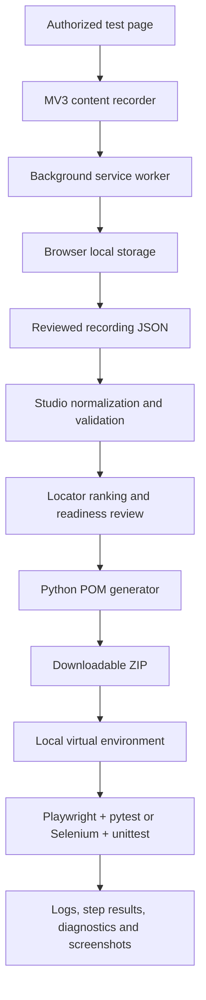

# Record2POM Architecture

**Product:** Record2POM Universal POM Automation Studio  
**Creator attribution:** Satyendra Kumar Namdeo

## Product boundaries

Record2POM is a local-first browser journey recorder and Python Page Object Model (POM) project generator. It is split into three execution zones:

1. **Browser extension** captures supported interactions on a user-selected HTTP/HTTPS page.
2. **Studio dashboard** validates and reviews a recording, then generates a downloadable project archive.
3. **Generated project** runs locally on the user's machine.

The hosted Studio does not execute customer tests. A generated ZIP is an artifact, not proof that a test passed.

## High-level data flow

## Repository map

| Path | Responsibility |
|---|---|
| `index.html`, `styles.css`, `app.js` | Studio UI, review workflow, project generation and downloads |
| `core.js` | Recording validation, normalization, aliases and locator ranking |
| `extension/manifest.json` | Manifest V3 permissions and extension entry points |
| `extension/recorder.js` | DOM event capture, accessible-name hints and sensitive-field handling |
| `extension/background.js` | Session lifecycle, storage, event validation and Studio handoff |
| `extension/popup.*` | Recorder controls and import acknowledgement UI |
| `tests/generator.test.mjs` | Fast Node regression suite for schemas, generation and extension contracts |
| `tests/e2e/` | Browser-driven Studio and generated-project integration tests |
| `fixtures/universal-demo/` | Synthetic HTML target used by automated tests |
| `showcase/` | GSAP motion showcase and product storytelling |
| `assets/` | README graphics, branded banners and motion SVGs |
| `docs/` | Architecture, recording contract, locator guidance, extension test plan and roadmap |
| `examples/` | Synthetic recording examples |

## Recording contract

A recording is versioned JSON with `schemaVersion`, `targetUrl`, optional non-sensitive `metadata`, and ordered `events`. Each event can contain an action kind, target hints, locator candidates and optional value/assertion data.

The canonical normalizer accepts selected legacy aliases and produces a consistent intermediate representation. The shared core caps recordings at 5,000 events and validates supported event kinds and string lengths. Schema changes should update the example, tests and [recording format guide](RECORDING_FORMAT.md).

## Generation pipeline

1. Validate and normalize imported data.
2. Review action count, locator quality, redaction and missing assertions.
3. Convert supported actions to engine-specific page-object calls.
4. Package source, tests, configuration, test data, local runner, validation helper and generated README.
5. Inspect the ZIP and run it locally.
6. Review diagnostics and test reports produced by that local run.

Supported outputs: **Python + Playwright + pytest** and **Python + Selenium WebDriver + unittest**. Other engines and languages are not implemented.

## Trust boundaries and data handling

- Target-page content and attributes are untrusted input.
- Extension sessions are held in browser local storage until cleared or exported.
- Sensitive-field and URL redaction is heuristic; inspect exports before sharing.
- Generated reports, screenshots and logs may contain page content or synthetic test values.
- The generated runner uses bounded execution but is not an operating-system sandbox. Inspect generated code and dependencies before running.
- Use systems you own or have explicit permission to test. Do not record production secrets or personal data.

## Diagnostics contract

The generated runner can emit structured result data, step timing/status, logs, HTML summaries and JUnit data (engine-dependent). Diagnostics should identify the failed action and provide repair guidance without exposing secrets. A future improvement is per-step screenshot capture with deliberate evidence redaction.

## Design principles

- **Review before execution:** generated code remains inspectable; no hidden remote execution.
- **Accessible locators first:** prefer test IDs and semantic role/label locators over brittle positional selectors.
- **Fail safely:** ambiguous or missing locators should produce actionable errors rather than selecting an arbitrary element.
- **Synthetic fixtures:** automated tests use deterministic local pages and synthetic values.
- **Progressive enhancement:** GSAP motion is decorative and must not block core functionality.
- **Honest status:** generation, CI, production deployment and manual browser smoke tests are distinct verification claims.

## Change checklist

For recording schema changes, update `core.js`, tests and the sample recording. For generator changes, assert generated source and execute it against the fixture. For extension changes, update message-contract tests and complete the installed-Chrome smoke test before claiming real-browser validation. For visual changes, preserve keyboard access, responsive layouts and `prefers-reduced-motion` support.
